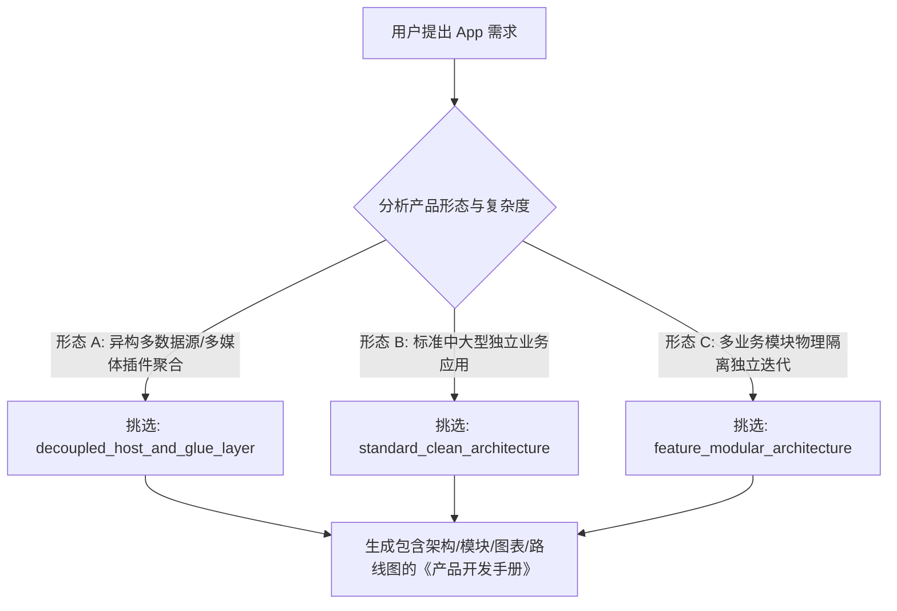
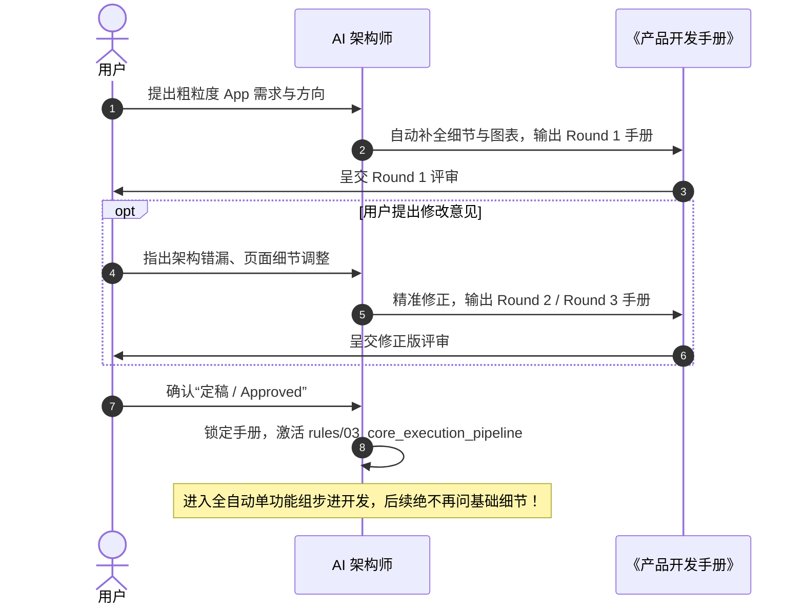

# Product Development Handbook Generator (产品开发手册生成总控器)

## 0. 核心定位与设计宗旨
本规约是 `developer/` 开发体系的**总干线引擎与最高指令路由器**。
当接收到用户提出做任何新 App 的需求时（例如“做一个壁纸应用”、“做一个背单词 App”），**AI 绝对不允许直接开始编写具体的业务代码，更不允许编写虚假 Mock 代码或 TODO 占位符**！
AI 必须以首席架构师与资深产品经理的身份，根据本规约自动补全产品与技术细节，生成一份标准、详尽、具备完整图表的《产品开发手册》（Product Development Handbook），并引导用户多轮评审定稿。

---

## 1. 架构选型与技能调度原则 (Architecture & Skill Dispatching)

AI 必须根据用户提出的 App 属性与业务复杂度，**按需挑选最匹配的架构与技能**，严禁盲目套用：



---

## 2. 《产品开发手册》必须补全的 6 大核心维度

在生成手册时，必须包含以下内容（**除了不写具体业务实现代码外，架构与技术细节必须 100% 面面俱到**）：

### 2.1 架构设计与技术栈选型
* 选定的架构模式及设计原因；
* 核心状态管理方案（如 Riverpod 3.0 规范，统一使用 Notifier/AsyncNotifier）；
* 数据持久化方案（如 Isar / SharedPreferences）；
* 涉及的微包或模块组织方式。

### 2.2 目录结构与模块物理边界 (Directory Tree)
* 列出完整的工程文件目录树；
* 明确规定每一个文件夹与子目录的**单一职责**；
* 强调物理隔离与依赖单向性，杜绝任何循环依赖与巨石文件。

### 2.3 逐页面与逐功能细节清单 (Feature Specifications)
* 每一个 UI 页面的名称、路由路径与页面脚手架结构；
* 页面包含的子组件拆分（必须遵守单文件 250 行红线与 Widget 抽离原则）；
* 页面对应的 Notifier 状态结构（Loading、Success、Empty、Error 状态定义）；
* 数据源获取、缓存与流转逻辑（如是否接入 2 阶秒开加载协议）。

### 2.4 可视化 Mermaid 图表 (Mandatory 3 Charts)
手册中必须包含以下 **3 个标准 Mermaid 图表**：
1. **文件目录树状图 (Directory Structure Tree)**；
2. **系统功能与模块拓扑图 (System Architecture & Module Topology)**；
3. **核心业务与数据流转图 (Business Logic & Data Flow)**。

### 2.5 关联 Specialized Skills 引用清单
* 列出手册在后续开发各个模块时，具体需要激活并遵循哪些 `developer/skills/` 下的专门技能（如 `self_critique_and_strict_execution`、`strict_user_instructions_compliance`、`prohibit_string_literals_protocol`、`naming_convention_protocol`、`zero_wheel_upstream_reuse_protocol`、`two_stage_snappy_loading_protocol` 等）。

### 2.6 功能组交付路线图 (Function Group Breakdown Roadmap)
* 必须在手册末尾，将系统严格切分为若干个颗粒度明确、可独立运行测试的**功能组 (Function Groups)**：
  ```text
  功能组 1: 底层持久化与核心实体模型组
  功能组 2: 网络通信与驱动/数据源解析组
  功能组 3: 状态管理中枢与业务逻辑组
  功能组 4: 基础 UI 框架与核心页面组
  功能组 5: 详情流转、三级消费与交互组
  功能组 6: 商业化变现与系统渠道集成组
  ```

---

## 3. 多轮评审定稿工作流 (Multi-Round Review Workflow)



---

## 4. 定稿后的全自动落地铁律

1. **零基础发问**：手册一旦定稿锁定，**后续开发过程中绝对禁止再就已定稿的基础设计、页面结构或技术选型打扰用户**！
2. **单功能组步进卡扣**：必须严格按照手册排定的路线图，**每次只专注于一个功能组**。编写 100% 真实生产代码，禁止假代码与 Mock 数据。
3. **独立测试验证通过才解锁下一个**：每个功能组完成后必须独立运行测试验证，并输出真实的明细凭据。测试全部跑通后，方可推进下一个功能组。
