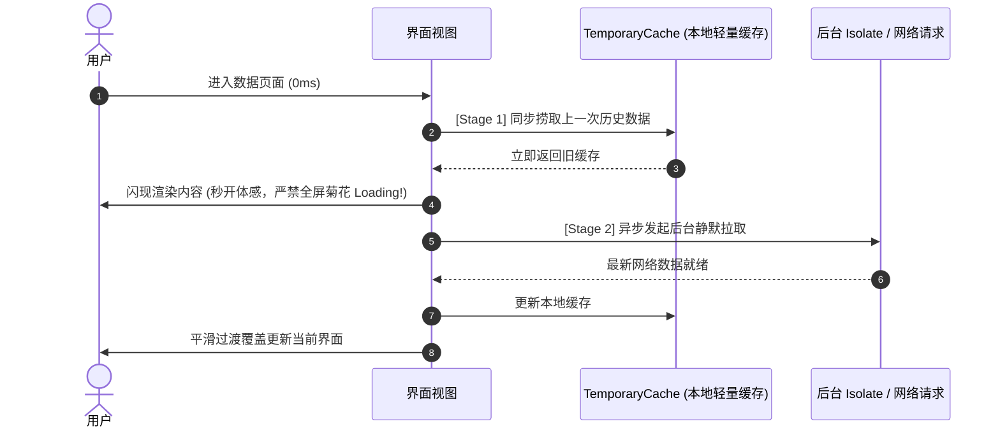

# Two-Stage Snappy Loading Protocol (2 阶秒开加载协议规范)

## 0. 适用场景
数据看板、内容 Feed 流、媒体探索列表、壁纸瀑布流等数据页面的极速加载。

---

## 1. 核心规约 (Two-Stage Pipeline)

### 1.1 Stage 1 (Sync Restore - 秒开同步闪现)
* 页面启动瞬间，必须**同步 (Sync)** 从 `TemporaryCache` 或本地数据库读取上一次的数据并立即渲染呈现；
* **绝对红线**：严禁在此阶段抛出全屏 Loading 菊花导致白屏等待。用户必须在打开页面的第一毫秒看到内容！

### 1.2 Stage 2 (Async Refresh - 静默平滑刷新)
* 旧内容展示后，后台异步发起网络请求或插件拉取；
* 新数据到来后，平滑覆盖旧数据并更新缓存，给用户极致流畅的刷新体验。
