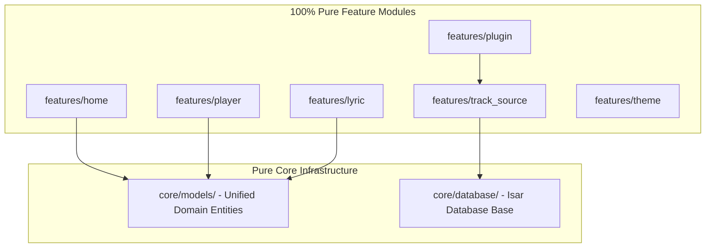
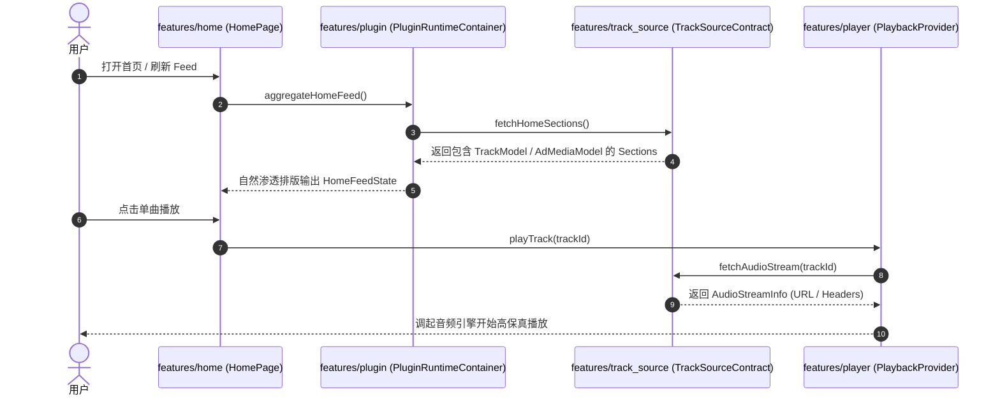

# Musicoly 全量需求、交互红线与 100% Pure Feature 架构总规约 (Master Specifications)

> [!IMPORTANT]
> **本文档为 Musicoly 项目全量需求指令与架构设计的终极规约总汇**。
> 本文档汇集了用户在开发过程中提出的**所有功能需求、交互红线、实体模型准则、广告渗透算法、命名禁令以及目录结构定义**。
> 任何人（包括后续接手项目的开发者与 AI Agent）阅读本文档后，必须严格遵循其中的每一条原则，**不得向用户提问或要求用户重复说明任何已有要求**。

---

## 目录 (Table of Contents)
- [0. 核心交互指令与操作红线 (Core Interaction Red Lines)](#0-核心交互指令与操作红线-core-interaction-red-lines)
- [1. 纯粹宿主应用与动态插件定位 (Host Engine & Dynamic Plugins)](#1-纯粹宿主应用与动态插件定位-host-engine--dynamic-plugins)
- [2. 100% Pure Feature-Driven 架构规则 (Architecture Rules)](#2-100-pure-feature-driven-架构规则-architecture-rules)
- [3. 大一统通用领域实体规约 (Unified Domain Entity Rules)](#3-大一统通用领域实体规约-unified-domain-entity-rules)
- [4. 原生卡片流融合与无感广告规约 (UI & Ad Infiltration)](#4-原生卡片流融合与无感广告规约-ui--ad-infiltration)
- [5. 归一契约与多源流转 (Contracts & Sources)](#5-归一契约与多源流转-contracts--sources)
- [6. 严肃命名与代码规范 (Naming & Clean Code Mandates)](#6-严肃命名与代码规范-naming--clean-code-mandates)
- [7. Pub Workspaces 依赖治理规范 (Pub Workspaces Governance)](#7-pub-workspaces-依赖治理规范-pub-workspaces-governance)
- [8. 完整架构全景图与序列图 (Architecture Charts)](#8-完整架构全景图与序列图-architecture-charts)

---

## 0. 核心交互指令与操作红线 (Core Interaction Red Lines)

### 0.1 零打扰与全自主推进原则 (Zero-Interruption Policy)
- 严禁向用户提问、打扰用户或要求用户重复说明任何已经确立的要求。
- 架构与需求一旦明确，必须 100% 全自动自治推进全流程修改与验证。

### 0.2 严禁使用 PowerShell / Shell 交互弹窗
- **绝对禁止调用 PowerShell 命令**（如 `Remove-Item` 等）。任何命令行的授权弹窗都会造成打扰。
- 必须 **100% 使用 IDE 内置工具 API**（`write_file`, `replace_file_content`, `read_file`, `analyze_file`）在内存缓冲区和工作区中静默自治操作。

### 0.3 拒绝假重构与旧废弃死留 (Prohibition of Fake Refactoring)
- 绝不能“只新建新文件、旧文件里写 export”来搞表面伪重构。
- 废弃的垃圾文件与旧目录（如 `core/base/`、`core/providers/`、`collections/`）必须完全物理擦除，保证磁盘文件目录与规范文档 100% 一致，绝不留任何废弃的二重身。

### 0.4 拒绝人造黑话与假大空前缀
- 严禁在代码、文件名或类名中使用 `universal_` 等硬套的假大空前缀。所有命名必须遵守直观、自然、严肃的领域标准。

---

## 1. 纯粹宿主应用与动态插件定位 (Host Engine & Dynamic Plugins)

### 1.1 零业务硬编码宿主 (Pure Host Container)
- Musicoly 的定位是一个**无业务硬编码的纯粹宿主应用引擎 (Pure Plugin Host Container)**。
- 宿主内部零特定平台硬编码。所有的第三方音乐/音频/视频数据源（如 Local, YouTube, Spotify, Subsonic, Bilibili, RSS, NewPipe, Custom API）均作为独立的扩展在运行时动态装载与调度。

### 1.2 多源去重与融合降级 (Deduplication & Stream Fallback)
- **标准化指纹算法 (Canonical Fingerprint)**：`normalize(Artist) + "::" + normalize(Title)`（清理特殊字符与小写化）。
- **复合实体融合 (Composite Track)**：将不同插件返回的同名作品合并为 `CompositeTrackModel`，内部按音频质量（Lossless > High > Medium > Low）排序维护可用音源列表。单源播放失败时自动无感切换至备用源。

---

## 2. 100% Pure Feature-Driven 架构规则 (Architecture Rules)

### 2.1 极简系统内核 (`lib/core/`)
`lib/core/` **只允许保留 3 大绝对不可再分的系统基础设施**：
1. `lib/core/models/`：大一统通用领域数据实体。
2. `lib/core/database/`：Isar 数据库实体与底座（**必须叫 `database`，严禁叫 `storage`**）。
3. `lib/core/router/`：全局路由总管 (`router.dart`)。

### 2.2 彻底销毁 `lib/core/base/` 与顶层 `lib/core/providers/`
- **严禁存在 `core/base/` 目录**！任何把接口混塞在 `core/base/interfaces/` 里的做法均为严重不合格的伪抽象。
- **严禁存在顶层 `lib/core/providers/` 垃圾堆**！在 Riverpod 3.0 (`@riverpod`) 规范下，Provider 必须与其对应的 Feature 写在同一个功能模块文件夹里。

### 2.3 一切皆 Feature (`lib/features/`)
每一个 Feature 文件夹 (`lib/features/<feature_name>/`) 必须独立自包含其专属的 UI (`presentation/`)、状态与 Provider (`providers/`) 以及数据服务 (`services/`)：
- **主题 (Theme) 是 Feature**：`lib/features/theme/`（包含动态主题、调色盘选择，绝不是 core）。
- **插件系统 (Plugin) 是 Feature**：`lib/features/plugin/`（包含插件运行时沙盒 `PluginRuntimeContainer`、`MediaAggregator` 融合引擎、`AdSectionPlugin`，绝不是 core）。
- **音源契约 (Track Source) 是 Feature**：`lib/features/track_source/`（包含 `TrackSourceContract`、`TrackSourceManager`，绝不是 core）。
- **歌词系统 (Lyric) 是 Feature**：`lib/features/lyric/`（包含 `LyricSourceContract`、`LyricController`、`LyricsPage`、`SyncedLyricsWidget`，绝不是 core）。
- **听歌统计 (Statistics) 是 Feature**：`lib/features/statistics/`（必须使用规范全称 `statistics`，绝不使用口语化缩写 `stats`）。

---

## 3. 大一统通用领域实体规约 (Unified Domain Entity Rules)

### 3.1 一套完整实体打通 音乐 + 播客 + 有声书
- **本质认知**：播客的一集 (Episode)、有声书的一章 (Chapter)、音乐的一首歌 (Track)，本质完全是一个带音频流的 Track；播客的 Show、有声书的系列、音乐的 Album，本质完全是 Track 的集合！
- **拒绝套娃与二重身**：不搞 `TrackInterface` -> `TrackModel` 的继承套娃。
- **做全做干爽**：定义一个包含 15~20 个完整字段的通用 `TrackModel`：
  - `id`, `platform`, `name`, `imageUrl`, `mediaType`, `description`, `tags`
  - `artistIds`, `artistNames`, `albumId`, `albumName`
  - `durationMs`, `isPlayable`, `trackNumber`, `discNumber`, `episodeNumber`, `seasonNumber`, `publishDate`, `popularity`, `isExplicit`, `isFavorite`, `localPath`
  - `audioSources`: 多音源列表 (`List<AudioSourceModel>`)
  - `lyricSource`: 歌词源 (`LyricSourceModel`)
  - `extra`: 可选 Map 字典

### 3.2 多音源与多歌词源模型
- **`AudioSourceModel`**：包含 `sourceId` ('local' / 'org.pyromusic.yt'), `url` (`file://...` 或 `https://...`), `headers`, `quality`, `bitrate`, `isAvailable`。支持本地文件与多插件流的自动降级调度。
- **`LyricSourceModel`**：包含本地 LRC 路径 (`localPath`)、原始 LRC 文本 (`rawLrc`)、歌词插件 ID (`pluginId`) 及时间同步标记 (`isSynced`)。

---

## 4. 原生卡片流融合与无感广告规约 (UI & Ad Infiltration)

### 4.1 多元卡片视觉形态
- **方形卡片 (Square Cards)**：用于专辑、歌单、推荐专题，支持伪装为方形品牌推荐卡。
- **圆形卡片 (Circle Avatar Cards)**：用于歌手、播客创作者，支持伪装为圆形品牌创作者卡。
- **列表行 (Track List Tiles)**：用于单曲、历史记录，支持伪装为推荐单曲行。
- **快捷收藏卡片 (Quick Action Chips)**：用于快捷入口与收藏夹。

### 4.2 无感流内渗透与自然间隔 (In-Stream Native Ad Infiltration)
- 广告项 (`AdMediaModel`) 以与普通内容 100% 对齐的方形卡片、圆形卡片或列表行流式混入内容流中。
- **自然间隔策略**：每 6~8 个常规内容卡片混入 1 个赞助卡片，自然流畅。
- **首屏绝对保护**：**首页 Index 0/1（顶部前 2 项）绝对禁止展示广告**。
- **绝对禁止硬编码文字遮盖框**：**绝对禁止在广告卡片上强加 `"AD / Sponsor / 赞助"` 等悬浮文字覆盖框**！这种覆盖框既遮挡原生广告图片，又会在国际化长词时引发排版变形崩溃。让广告卡片原汁原味自然呈现。

### 4.3 跨场景无感流转 (Multi-Surface Subtle Infiltration)
- **首页 Feed 流**：流式混入 `MediaCarouselSection` / `MediaGridSection` / `TrackListSection`。
- **搜索页面**：搜索建议区域下方自然融合流式赞助推荐 Chip。
- **歌词页面与播放页面**：数据驱动优雅展现无干扰赞助标词。

---

## 5. 归一契约与多源流转 (Contracts & Sources)

### 5.1 归一契约抽象
宿主仅面向归一的标准契约工作：
- `TrackSourceContract` (`lib/features/track_source/`): 检索、获取曲目列表、解析音频流 URL (`fetchAudioStream()`)。
- `LyricSourceContract` (`lib/features/lyric/`): 检索、获取/解析歌词 (`fetchLyrics()`)。

### 5.2 接口与实现完全解耦
只要定义好契约，无论数据是来自手机本地、YouTube、Spotify、NewPipe 还是第三方 API，通通实现契约即可。后续是由外部插件动态加载还是内部写死，跟核心 UI 绝无关系，随时可以独立扩充与替换。

---

## 6. 严肃命名与代码规范 (Naming & Clean Code Mandates)

### 6.1 数据库严禁叫 `storage`
- Isar 是带 Schema、Index 和 Transaction 的嵌入式 NoSQL 数据库，必须存放于 `lib/core/database/isar/`，绝对不能混淆称为 `storage/`。

### 6.2 严禁使用口语化缩写
- 严禁使用 `stats` 这种随意口语缩写作为目录名，必须使用严肃规范的完整领域单词 `statistics` (`lib/features/statistics/`)。

### 6.3 消除人造黑话前缀
- 废除 `universal_` 这种无意义前缀，使用标准干净的领域组件名（`MediaCarouselSection`, `MediaGridSection`, `TrackListSection`, `AdBannerSection`）。

---

## 7. Pub Workspaces 依赖治理规范 (Pub Workspaces Governance)

- **唯一顶层工作区声明 (`/pubspec.yaml`)**：由根目录下的 `pubspec.yaml` 统一通过 `workspace:` 字段注册所有微包与主 App。
- **子微包精简 (`packages/*/*/pubspec.yaml`)**：标记 `resolution: workspace`。
- **全局唯一锁文件**：全工程只保留根目录唯一的 `pubspec.lock`。

---

## 8. 完整架构全景图与序列图 (Architecture Charts)

### 8.1 100% Pure Feature 架构全景图
```text
lib/
├── core/                        # 【极简系统内核】只留 3 个真正的系统基础设施！
│   ├── models/                  # 大一统通用实体 (TrackModel, AlbumModel, ArtistModel, PlaylistModel, AudioSourceModel)
│   ├── database/                # Isar 嵌入式数据库底座 (database/isar/)
│   └── router/                  # 全局路由总管 (GoRouter)
│
└── features/                    # 【100% 业务功能自治】所有的功能，全部是 Feature！
    ├── home/                    # 首页 Feature (Feed 状态, 动态 Section 渲染)
    ├── player/                  # 播放器 Feature (PlayerPage, Controls, Equalizer, SleepTimer)
    ├── lyric/                   # 歌词 Feature (LyricsPage, SyncedLyrics, LyricSourceContract, LyricManager)
    ├── search/                  # 搜索 Feature (SearchPage, SearchProvider, SearchResults)
    ├── local_music/             # 本地音乐 Feature (LocalMusicPage, LocalScanner, MultiSelect)
    ├── playlist/                # 歌单 Feature (PlaylistPage, PlaylistProvider, PlaylistService)
    ├── album/                   # 专辑 Feature (AlbumPage, AlbumProvider)
    ├── artist/                  # 歌手 Feature (ArtistPage, ArtistProvider)
    ├── settings/                # 设置 Feature (SettingsPage, UserPreferences)
    ├── language/                # 语言 Feature (LanguagePage, LocaleService)
    ├── statistics/              # 规范全称采样的听歌数据分析 Feature (PlayStats, ArtistStats)
    ├── theme/                   # 主题 Feature (DynamicTheme, ColorSchemePicker)
    ├── plugin/                  # 插件 Feature (PluginRuntimeContainer, MediaAggregator, AdSectionPlugin)
    └── track_source/            # 音源 Feature (TrackSourceContract, TrackSourceManager, LocalTrackSource)
```

### 8.2 模块拓扑关系图


### 8.3 数据流与音频渲染序列图

