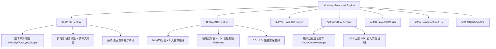
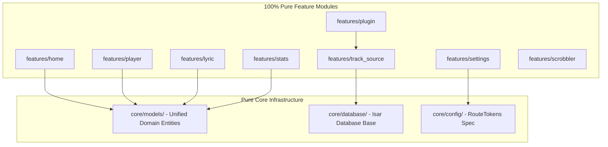

# Musicoly (Pyro Music) 工业级全量功能与开发者手册 (Comprehensive Developer Handbook)

## 📌 概述与总控指导原则

Musicoly 致力于构建一个**无业务硬编码的纯粹宿主应用引擎 (Pure Plugin Host Container)**。本手册全面整合了系统架构设计、核心功能矩阵、工业级依赖治理、代码命名规范、性能体验标准与开源复用规约，是全工程统一的终极研发总手册。

---

## 0. 核心定位与设计宗旨

1. **纯粹宿主应用容器**：宿主应用内部零特定平台/业务硬编码。所有的第三方音频/视频数据源（本地、YouTube、Spotify、Subsonic、Listen1、Bilibili 等）均作为独立的扩展在运行时动态装载与调度。
2. **100% Pure Feature-Driven 干净架构**：彻底销毁 `core/base/` 垃圾文件夹与顶层 `core/providers/`。`lib/core/` 只保留绝对不可再分的系统基础设施（领域模型 `models/`、数据库底座 `database/isar/`、路由总管 `router/` 与路由 Tokens `config/`）。
3. **大一统通用 Domain 实体**：音乐单曲、播客单集 (Episode)、有声书章节 (Chapter) 统一使用 15~20 字段的干爽实体 `TrackModel`（内置多音源 `audioSources` 与歌词源 `lyricSource`），零接口套娃。

---

## 1. 全量功能矩阵大一统 (Comprehensive Feature Matrix)

本工程集成了从 32+ 顶级开源音乐播放器（如 `namida`, `OuterTune`, `InnerTune`, `spotube`, `spmp`, `SimpMusic`, `BlackHole`, `Musify` 等）抽取并重构的完整核心功能：



### 1.1 歌词引擎 (Lyrics Subsystem)
- **逐字高亮平滑动画 (`WordByWordLyricWidget`)**：支持字词级时间戳，播放至对应音节时触发平滑发光高亮与缩放渐变动效。
- **音译/拼音与多语言翻译**：`LrcParser` 解析器支持同屏对齐渲染罗马音/拼音 (`romanization`) 与译文。
- **系统/桌面悬浮歌词 (`FloatingLyricsService` & `floating_lyric_window.dart`)**：置顶悬浮小窗歌词展示，支持锁字与透明度调节。

### 1.2 音效与睡眠播控 (Audio Effects & Playback Control)
- **10 段精细均衡器与预设 (`EqualizerService`)**：内置 `Pop`, `Rock`, `Bass Boost`, `Vocal Boost`, `Classical`, `Electronic`, `Jazz`, `Flat` 等经典预设，支持手势频段调控。
- **睡眠定时器 (`SleepTimerDialog` & `sleepTimerProvider`)**：支持 15/30/45/60/90 分钟自由倒计时或曲终停播，倒计时最后 15 秒触发**音量平滑渐隐 (Fade-out)** 停止播放。
- **倍速与变调**：支持 0.5x - 2.0x 独立速度与音高微调。

### 1.3 听歌统计与个人报告 (`ListeningStatsPage`)
- **数据可视化与分析**：自动记录累计听歌时长、播放首数、Top 10 最常听单曲/歌手，并呈现图表卡片。

### 1.4 智能离线缓存与存储管理 (`AudioCacheManager` & `CacheSettingsPage`)
- **边听边存 (Stream Caching)**：播放在线歌曲时自动后台流式写入本地缓存，无网无缝重定向至本地缓存。
- **缓存容量上限控制**：可视化占用进度、预加载开关与 2GB 最大容量 LRU 自动清理。

### 1.5 桌面集成与迷你播放器 (`DesktopService` & `mini_player_window.dart`)
- 轻量置顶悬浮迷你播放器 UI，支持专辑封面、曲目信息、进度条控制与拖拽。

### 1.6 ListenBrainz 听歌记录与打卡 (`ListenBrainzScrobbler`)
- 集成 ListenBrainz API (`playing_now` 与 `submit-listens`)，接入通用 `ScrobblerManager` 插件架构。

### 1.7 全量数据备份与恢复 (`BackupService`)
- 一键将歌单、收藏夹、听歌历史、设置与插件配置导出为 JSON/ZIP 备份与无损还原。

### 1.8 强类型路由 Token 机制 (`RouteTokens`)
- 所有路由路径收口于强类型静态常量类 `RouteTokens`（如 `RouteTokens.home`, `RouteTokens.stats`, `RouteTokens.cacheSettings`），彻底消除硬编码 Bare String。

---

## 2. 100% Pure Feature-Driven 目录结构规范

```text
lib/
├── core/                        # 【极简系统内核】只留 4 个真正的系统基础设施！
│   ├── models/                  # 大一统通用实体 (TrackModel, AlbumModel, ArtistModel, PlaylistModel, AudioSourceModel)
│   ├── database/                # Isar 嵌入式数据库底座 (database/isar/)
│   ├── router/                  # 全局路由总管 (GoRouter)
│   └── config/                  # 系统路由 Tokens 与全局强类型 Token 配置 (route_tokens.dart)
│
└── features/                    # 【100% 业务功能自治】所有的功能，全部是 Feature！
    ├── home/                    # 首页 Feature (Feed 状态, 动态 Section 渲染)
    ├── player/                  # 播放器 Feature (PlayerPage, Controls, Equalizer, SleepTimer)
    ├── lyric/                   # 歌词 Feature (LyricsPage, SyncedLyrics, WordByWordLyric, FloatingLyrics)
    ├── search/                  # 搜索 Feature (SearchPage, SearchProvider, SearchResults)
    ├── local_music/             # 本地音乐 Feature (LocalMusicPage, LocalScannerProvider)
    ├── playlist/                # 歌单 Feature (PlaylistPage, PlaylistProvider)
    ├── album/                   # 专辑 Feature (AlbumPage, AlbumProvider)
    ├── artist/                  # 歌手 Feature (ArtistPage, ArtistProvider)
    ├── settings/                # 设置 Feature (SettingsPage, UserPreferences, CacheSettingsPage)
    ├── stats/                   # 听歌统计 Feature (ListeningStatsPage, PlayStatsProvider)
    ├── theme/                   # 主题 Feature (DynamicTheme, ColorSchemePicker)
    ├── scrobbler/               # 打卡 Feature (ScrobblerManager, ListenBrainzScrobbler)
    ├── plugin/                  # 插件 Feature (PluginRuntimeContainer, MediaAggregator)
    └── track_source/            # 音源 Feature (TrackSourceContract, TrackSourceManager)
```

---

## 3. 四大开发者工程红线 (Core Engineering Standards)

### 3.1 命名禁忌红线 (Naming Convention Protocol)
- **严禁 `my_` / `My` 前缀**：不得使用 `my_profile`、`my_apps`，使用具体领域角色名词（如 `user_dossier`）。
- **严禁 `app_` / `App` 前缀**：单体工程内部严禁为文件或组件加 `app_` 冗余前缀（如 `root_router.dart` ✅，`theme_registry.dart` ✅，`system_config.dart` ✅）。

### 3.2 零硬编码字符串与零魔数红线 (Prohibit String Literals Protocol)
- **零字符串魔数**：业务逻辑、音效/排版类型中 100% 禁止硬编码带引号的文本字面量。
- **零裸路由字面量**：跳转统一引用静态强类型 Token `RouteTokens`。
- **零 `switch/case` 分支**：通过多态、枚举标量与能力自注册替代手写冗长 `switch/case` 逻辑。
- **UI 国际化 100% 覆盖**：面向用户的界面文本必须从 `AppLocalizations` 读取。

### 3.3 2 阶秒开加载协议 (Two-Stage Snappy Loading Protocol)
- **Stage 1 (Sync Restore)**：页面启动瞬间同步捞取本地历史缓存渲染呈现，严禁抛出全屏菊花 Loading！
- **Stage 2 (Async Refresh)**：后台静默异步拉取最新网络数据，就绪后平滑淡入覆盖更新。

### 3.4 零造轮子与开源复用铁律 (Zero Wheel & Upstream Reuse Protocol)
- **开源优先**：公网存在成熟稳定解决方案时 100% 优先引入复用。
- **正交扩展桥接 (Decoupled Extension Bridge)**：第三方/上游库保持 1:1 原封不动，扩展逻辑解耦挂载。

---

## 4. 依赖治理规范 (Pub Workspaces Standard)

- **唯一顶层工作区声明 (`/pubspec.yaml`)**：根目录 `pubspec.yaml` 统一通过 `workspace:` 管理所有微包与主 App。
- **子微包精简 (`packages/*/*/pubspec.yaml`)**：标记 `resolution: workspace`。
- **全局唯一锁文件**：全工程只保留根目录唯一的 `pubspec.lock`。

---

## 5. 可视化架构拓扑图


