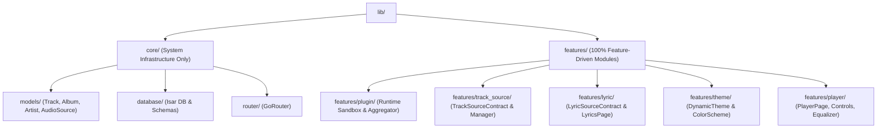
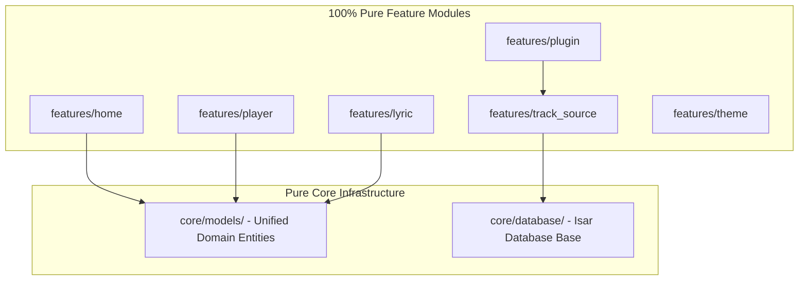
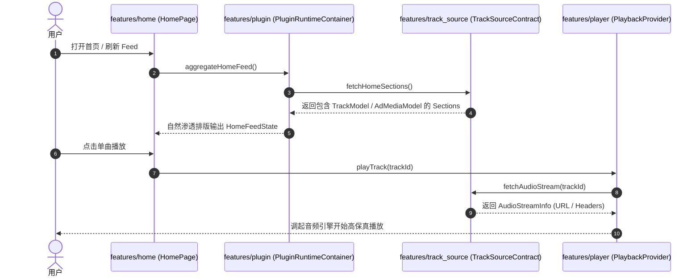

# Musicoly 100% Pure Feature-Driven Clean Architecture 产品开发手册

## 📌 需求与规约索引

> [!IMPORTANT]
> **完整用户需求指令、全量交互红线与架构总规约详见主文档**：
> 👉 [Master Specifications 需求规约总汇](file:///C:/Users/Ngokel/Desktop/en/music/pyromusic/docs/MASTER_SPECIFICATIONS.md)

---

## 0. 核心定位与设计宗旨 (Core Vision & Pure Feature Principles)

Musicoly 致力于构建一个**无业务硬编码的纯粹宿主应用引擎 (Pure Plugin Host Container)**。
本手册为 Musicoly 100% Pure Feature-Driven 终极架构与落地规范。彻底销毁一切跨目录杂乱堆放与伪 core（彻底废除 `core/base/` 垃圾文件夹与顶层 `core/providers/`），建立**极致纯粹、百分之百功能自治的 Feature 架构**：

1. **`lib/core/` 只保留绝对不可再分的 3 大系统基础设施**：通用领域实体 (`models/`)、数据库底座 (`database/isar/`)、全局路由总管 (`router/`)。
2. **一切皆 Feature！**：主题 (`features/theme/`)、插件系统 (`features/plugin/`)、音源契约 (`features/track_source/`)、歌词系统 (`features/lyric/`)、听歌统计 (`features/statistics/`) 通通是高内聚自包含的 Feature！
3. **大一统通用 Domain 实体**：音乐单曲、播客单集 (Episode)、有声书章节 (Chapter) 统一使用 15~20 字段的干爽实体 `TrackModel`（内置 `audioSources` 与 `lyricSource`），零接口套娃。

---

## 1. 核心目录与物理边界 (Directory Tree)

```text
lib/
├── core/                        # 【极简系统内核】只留 3 个真正的系统基础设施！
│   ├── models/                  # 大一统通用实体 (TrackModel, AlbumModel, ArtistModel, PlaylistModel, AudioSourceModel)
│   ├── database/                # Isar 嵌入式数据库底座 (database/isar/)
│   └── router/                  # 全局路由总管 (GoRouter)
│
└── features/                    # 【100% 业务功能自治】所有的功能，全部是 Feature！
    ├── home/                    # 首页 Feature (Feed 状态, 动态 Section 渲染器)
    ├── player/                  # 播放器 Feature (PlayerPage, Controls, Equalizer, SleepTimer, PlaybackProvider)
    ├── lyric/                   # 歌词 Feature (LyricsPage, SyncedLyrics, LyricSourceContract, LyricManager)
    ├── search/                  # 搜索 Feature (SearchPage, SearchProvider, SearchResults)
    ├── local_music/             # 本地音乐 Feature (LocalMusicPage, LocalScannerProvider, MultiSelectProvider)
    ├── playlist/                # 歌单 Feature (PlaylistPage, PlaylistProvider, PlaylistService)
    ├── album/                   # 专辑 Feature (AlbumPage, AlbumProvider)
    ├── artist/                  # 歌手 Feature (ArtistPage, ArtistProvider)
    ├── settings/                # 设置 Feature (SettingsPage, UserPreferences)
    ├── language/                # 语言 Feature (LanguagePage, LocaleService)
    ├── statistics/              # 规范全称采样的听歌数据分析 Feature (PlayStats, ArtistStats)
    ├── theme/                   # 主题 Feature (DynamicTheme, ColorSchemePicker)
    ├── plugin/                  # 插件 Feature (PluginRuntimeContainer, MediaAggregator, AdSectionPlugin)
    └── track_source/            # 音源 Feature (TrackSourceContract, TrackSourceManager, LocalTrackSource)
```

---

## 2. 逐模块细节清单 (Feature Specifications)

### 2.1 极简 Core 基础设施
- `lib/core/models/`：大一统 `TrackModel`、`AlbumModel`、`ArtistModel`、`PlaylistModel`、`AudioSourceModel`、`LyricSourceModel`。
- `lib/core/database/`：`Isar` 数据库实体与服务。
- `lib/core/router/`：`GoRouter` 全局路由配置。

### 2.2 特征自治模块 (Features)
- `features/plugin/`：`PluginRuntimeContainer` 沙盒、`MediaAggregator` 1:6 流内自然渗透引擎、`AdSectionPlugin`。
- `features/track_source/`：`TrackSourceContract` 音源契约与 `TrackSourceManager`。
- `features/lyric/`：`LyricSourceContract` 歌词契约与 `LyricController`。
- `features/theme/`：动态主题与调色盘。
- `features/statistics/`：规范全称采样的听歌数据分析。

---

## 3. 可视化 Mermaid 图表 (Mandatory 3 Charts)

### Chart 1: 文件目录树状图 (Directory Structure Tree)


### Chart 2: 系统功能与模块拓扑图 (System Architecture & Module Topology)


### Chart 3: 核心业务与数据流转图 (Business Logic & Data Flow)


---

## 4. 功能组交付路线图 (Function Group Breakdown Roadmap)

```text
功能组 1: 大一统 Universal 实体与数据库底座组
  - 交付: lib/core/models/*, lib/core/database/isar/*

功能组 2: 插件与音源 Feature 模块内聚组
  - 交付: lib/features/plugin/*, lib/features/track_source/*, lib/features/lyric/*

功能组 3: 100% 自包含 UI Feature 模块重构组
  - 交付: features/home, features/player, features/search, features/settings, features/theme...

功能组 4: 路由对齐与规约归档
  - 交付: docs/PRODUCT_DEVELOPMENT_HANDBOOK.md, docs/MASTER_SPECIFICATIONS.md
```
